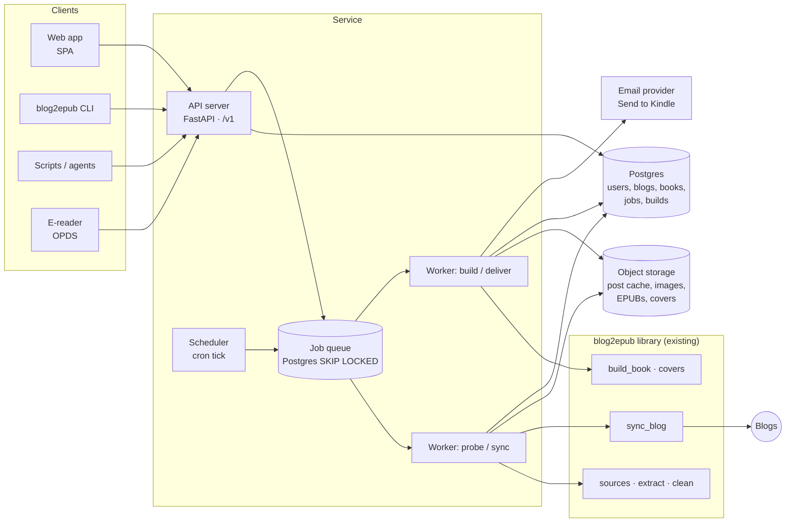
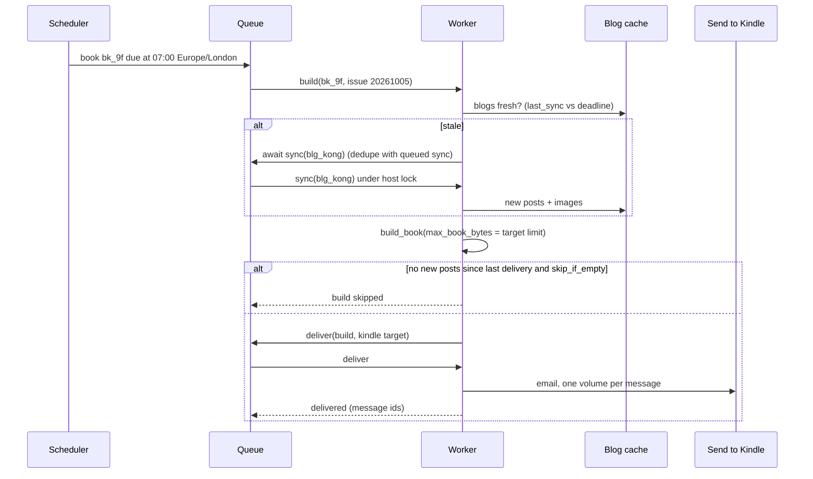

# Design: blog2epub as a service — an API first, a web app on top

Status: **proposal**, for discussion. Nothing here is built yet.
Companion contract: [`openapi.yaml`](openapi.yaml).

## 1. What we are building

Today blog2epub is a CLI driven by one `blogs.yaml`, run by a maintainer and by GitHub Actions,
publishing a fixed shelf of nine books as releases. The proposal is to let anyone do what the
maintainer does — point it at the blogs they read and get books on their e-reader — through a
web app in the spirit of [RSS to Kindle](https://www.rsstokindle.com/app):

1. **Add a blog** by pasting a URL, and see what blog2epub would make of it before committing.
2. **Compose a book**: one blog's archive, or a digest of several over a rolling window.
3. **Get it**: download now, deliver on a schedule to a Kindle address, or pull it from an OPDS
   catalogue on the reader itself.

It is **API first**: every one of those actions is an HTTP endpoint with a published OpenAPI
contract, and the web app is just one client of it, with no private back door. The CLI, a
future mobile client, scripts and other agents all use the same surface.

### What blog2epub already does better than a feed-to-Kindle service

RSS to Kindle and similar services send *the latest items in a feed*. blog2epub's pipeline does
three things they do not, and the product should lead with them:

- **Complete archives, not the last ten posts.** Source choice by coverage (WordPress API →
  sitemap → feed) means a book can hold 2,505 posts back to 2008.
- **Clean chapters.** `keep`/`remove` recipes and the bleed check mean a chapter is the article,
  not the article plus twenty prerendered related-post cards.
- **Real books.** Year → month navigation, excerpts, per-volume covers, epubcheck-clean output,
  and volume splitting that already knows about Send to Kindle's size limits.

### Non-goals (for now)

- Paywalled or logged-in content. We never hold third-party credentials.
- Public sharing of user-built books. A user's books are private to them; the public shelf stays
  the curated releases.
- Replacing `blogs.yaml`. It remains a first-class format: the service imports and exports it.
- Arbitrary user-supplied cover templates or CSS (see [§8](#8-security-and-abuse)).

## 2. Principles carried over from the CLI

These are the rules in `AGENTS.md`, restated for a service with many users. They shape the design
more than any framework choice does.

| Rule today | What it becomes in a service |
| --- | --- |
| Be polite: ≥ 0.5 s between requests, honest User-Agent, one host at a time | **One shared cache per blog, not per user.** A thousand subscribers to Kong cost Kong one sync. Syncs are scheduled by the service, never triggered directly by users. Per-host locks become distributed locks. |
| Read `robots.txt` before crawling | Checked automatically for every user-submitted blog; a disallow blocks the source. |
| Books are for personal reading; every chapter links back | User books are private and never listed publicly. Attribution stays on the title page and every chapter. A per-host opt-out list honours takedown requests. |
| Every book passes epubcheck with zero warnings | Unchanged. The worker builds with exactly the library code the CLI uses; CI keeps the epubcheck suite. |
| Images are always optimised | Unchanged, and optimised images are cached per `(url, width, quality)` so a digest built for 500 users re-encodes each image once. |
| A recipe is an investigation, not a guess | User-added blogs start as **auto** recipes (source detection + readability). Curated recipes — the ones in `blogs.yaml` — are promoted by a maintainer after the `/add-blog` checks. The UI says which a blog is. |

## 3. Architecture



Four deployable pieces, all from one Python package so they can never drift apart:

| Piece | What it does | Scales with |
| --- | --- | --- |
| **API server** (`blog2epub.api`) | Auth, validation, CRUD, enqueues jobs, streams job progress, serves signed download links and OPDS | requests; stateless |
| **Worker** (`blog2epub.worker`) | Runs `probe`, `sync`, `build`, `deliver` jobs by calling the existing library | CPU (image optimisation, builds) and politeness budget (syncs) |
| **Scheduler** | Every minute: enqueue due deliveries; keep blog caches fresh | one instance (leader lock) |
| **Web app** | Static SPA built against the generated TypeScript client | CDN |

The CLI keeps working exactly as it does today against local files. A later `--remote` mode can
point it at the API, but that is not needed for anything below.

### Technology choices, with the reason for each

- **FastAPI + Pydantic v2.** Python, so it imports the library directly; OpenAPI and JSON Schema
  come out of the models, and the web app's forms are generated from that schema.
- **Postgres** for everything relational *and* the job queue (`SELECT … FOR UPDATE SKIP LOCKED`,
  e.g. via Procrastinate). One stateful dependency instead of Postgres + Redis. Advisory locks
  give us the distributed per-host lock for free.
- **Object storage (S3/R2/MinIO)** for the post cache, images, EPUBs and covers. Local filesystem
  in single-node mode — the default for self-hosting — so `docker compose up` needs no cloud.
- **Web app: React + Vite + TanStack Query** with a client generated by `openapi-typescript`.
  The generated client is the enforcement of API-first: if the web app needs something the
  contract lacks, the contract changes first. (SvelteKit in static mode is an equally good
  choice; the point is a static SPA with no server of its own.)
- **Playwright/Chromium in the worker image** only, for cover rendering, as `release.yml` does
  today.

## 4. Domain model

```mermaid
erDiagram
  USER ||--o{ BOOK : owns
  USER ||--o{ DELIVERY_TARGET : has
  USER ||--o{ API_TOKEN : has
  BLOG ||--o{ POST : caches
  BOOK }o--o{ BLOG : "draws from"
  BOOK ||--o| SCHEDULE : has
  BOOK ||--o{ BUILD : produces
  BUILD ||--|{ VOLUME : "split into"
  BUILD ||--o{ DELIVERY : "sent as"
  DELIVERY }o--|| DELIVERY_TARGET : to
  JOB }o--o| BLOG : "probe/sync"
  JOB }o--o| BUILD : "build"
  JOB }o--o| DELIVERY : "deliver"
```

| Entity | Maps to today | Notes |
| --- | --- | --- |
| **Blog** | a `blogs:` entry → `BlogConfig` | **Shared across users**, unique by canonical URL. Holds the recipe (`source`, `include`, `exclude`, `keep`, `remove`, `sitemap`, …) as JSON validated by `BlogConfig`. `tier`: `curated` (from `blogs.yaml`, maintainer-owned) or `auto` (user-submitted, detection + readability only). Also: `status` (`active`, `blocked_robots`, `failing`, `opted_out`), `last_sync`, `post_count`, `first_date`/`last_date`. |
| **Post** | `cache/<id>/index.json` entries | The index moves to a table (key, url, title, date, modified, fetched_at) so the API can list, search and count posts without reading JSON files. The body and images stay in the blob cache, exactly as `BlogStore` lays them out. |
| **Book** | a `books:` entry → `BookConfig` | **Per user.** `blogs` + the book options (`since`, `until`, `max_posts`, `group_by`, `order`, `split`, `max_book_bytes`, `cover` from the curated set, `featured_images`, …). A standalone blog book is just a book with one blog. |
| **Schedule** | the monthly cron in `release.yml` | `daily` / `weekly (weekday)` / `monthly (day)`, a local time and a timezone, `skip_if_empty`. |
| **Build** | one `build_book` call / one release issue | `issue` (YYYYMMDD), `edition` (`standard`/`collectors`), status, the `BuildResult` of every volume. Files expire after 30 days; the book can always be rebuilt. |
| **Volume** | one `BuildResult` | path in object storage, `label`, `posts`, `images`, `bytes`, `first_date`, `last_date`, cover image. |
| **DeliveryTarget** | — | `kindle_email` (`…@kindle.com`), `email`, `webhook`. `max_bytes` per kind drives the volume split (see [§6](#6-delivery)). |
| **Delivery** | — | one build → one target: status, provider message id, error. |
| **Job** | a CLI invocation | `probe`, `sync`, `build`, `deliver`; status, progress, log lines, result. |

The book-to-blog relationship is many-to-many **by reference**: a user's book never copies a
recipe. When a maintainer fixes Kong's `remove` selectors, every user's Kong book gets cleaner
at its next build, because `keep`/`remove` are applied to the cached body at build time.

## 5. The API

Base path `/v1`. JSON everywhere; errors are RFC 9457 `application/problem+json`. The full
contract is in [`openapi.yaml`](openapi.yaml); this section is the shape and the reasoning.

### Resources

| Resource | Endpoints | Notes |
| --- | --- | --- |
| Session & tokens | `GET /me` · `GET/POST /tokens` · `DELETE /tokens/{id}` | Web app: session cookie (OIDC or email magic link). Everything else: `Authorization: Bearer` personal tokens, scoped (`books:read`, `books:write`, `deliveries:write`). |
| Probes | `POST /probes` → 202 · `GET /probes/{id}` | Wraps `scripts/probe_blog.py`: sources that answer with post counts, URL shape and suggested `include`, sample extractions, bleed, brand colours, a draft recipe. Also how a blog gets added. |
| Blogs | `GET /blogs?q=&tier=` · `GET /blogs/{id}` · `POST /blogs` · `GET /blogs/{id}/posts` · `GET /blogs/{id}/posts/{key}` | `POST /blogs` takes a completed probe id; a URL that already exists returns `303 See Other` to the existing blog. Post bodies come back cleaned, as the chapter would render them — that is the preview. Users cannot edit a shared recipe; they can *propose* one (`POST /blogs/{id}/recipe-proposals`). |
| Catalogue | `GET /catalogue` | The curated shelf (today's nine books) with links to the latest release files. Needs no account. |
| Books | `GET/POST /books` · `GET/PATCH/DELETE /books/{id}` · `GET /books/{id}/preview` | `PATCH` is JSON Merge Patch. `preview` returns what a build would contain — volumes, post counts, TOC — without building, from `select_entries` + `plan_volumes`. |
| Builds | `POST /books/{id}/builds` → 202 · `GET /books/{id}/builds` · `GET /builds/{id}` · `GET /builds/{id}/volumes/{n}/epub` → 302 · `…/cover` | `Idempotency-Key` honoured. The download is a short-lived signed object-storage URL. |
| Schedules | `PUT/GET/DELETE /books/{id}/schedule` | One schedule per book; `PUT` because it is a singleton sub-resource. |
| Delivery targets | `GET/POST /delivery-targets` · `DELETE /delivery-targets/{id}` · `POST /delivery-targets/{id}/test` | `test` sends a one-page EPUB so the user can confirm their approved-sender list. |
| Deliveries | `POST /builds/{id}/deliveries` → 202 · `GET /deliveries?book=` | Send an existing build somewhere. Scheduled runs create these themselves. |
| Jobs | `GET /jobs/{id}` · `GET /jobs/{id}/events` (SSE) · `POST /jobs/{id}/cancel` | Every 202 above returns `Location: /v1/jobs/{id}`. |
| Config interop | `GET /config.yaml` · `POST /config.yaml` | Export the user's books and the recipes they use as a valid `blogs.yaml`; import one. The round trip goes through `load_config`, so it is validated the same way. |
| OPDS | `GET /opds/{feed_token}/catalog.xml` | An OPDS 1.2 acquisition feed of the user's latest builds, for KOReader, Kobo (via plugins), Moon+ and others. Token in the path, because readers cannot send headers; revocable. |
| Webhooks | outbound `build.succeeded`, `build.failed`, `delivery.failed` | Signed (HMAC) and retried. |
| Admin | `POST /admin/blogs/{id}/promote` · `…/block` · `GET /admin/recipe-proposals` | Maintainers turn an `auto` blog into a `curated` one after the `/add-blog` checks. |

### Conventions

- **Long work is a job, never a long request.** Probe, sync, build and deliver take seconds to
  hours (a full MuleSoft sync is ~40 s *per batch*). They return `202 Accepted` with the job, and
  progress streams over SSE (`GET /jobs/{id}/events`), which a browser `EventSource` and `curl -N`
  both read. Events are the library's own milestones: `listed 2737`, `fetched 120/2737`,
  `images 40 fetched, 2 failed`, `volume 2 of 3 written`.
- **Validation errors name the field.** `ConfigError` messages are already precise
  (`book 'x': \`split\` must be one of [...]`). The API raises them as 422 problems with an
  `errors[].pointer` (`/split`) so the web form can put the message next to the input.
- **Cursor pagination** (`?cursor=&limit=`, `next` in the body and in `Link`) on every list. Post
  lists get long: Axway is 1,968 posts.
- **ETags + `If-Match`** on books and schedules, so two tabs cannot silently overwrite each other.
- **Idempotency-Key** on every `POST` that starts work. A retried "build now" must not build twice.
- **Rate limits** with `RateLimit` headers: probes and builds are the expensive calls.
- **Versioning**: `/v1` in the path; additive changes only within it.

### Example: from a URL to a book

```http
POST /v1/probes
{"url": "https://konghq.com/blog"}

202 Accepted
Location: /v1/jobs/job_7Qx
{"id": "prb_3Kd", "status": "running", "job": "job_7Qx"}
```

```http
GET /v1/probes/prb_3Kd

200 OK
{
  "id": "prb_3Kd",
  "status": "succeeded",
  "url": "https://konghq.com/blog",
  "existing_blog": null,
  "robots": {"allowed": true},
  "sources": [
    {"name": "feed",    "posts": 10,  "note": "a feed lists only the latest posts"},
    {"name": "sitemap", "posts": 901, "url": "https://konghq.com/sitemaps/blogs.xml", "recommended": true}
  ],
  "url_shape": {"depths": {"2": 12, "3": 889}, "suggested_include": ["^https://konghq\\.com/blog/[^/]+/[^/]+"]},
  "samples": [
    {"url": "https://konghq.com/blog/engineering/…", "title": "…", "date": "2026-08-14", "chars": 9120, "bleed": ["Kafka at the edge"]}
  ],
  "bleed_count": 5,
  "draft": {"source": "sitemap", "sitemap": {"url": "https://konghq.com/sitemaps/blogs.xml"}, "include": ["…"]},
  "brand_colours": ["#ccff00", "#0b0d0f"]
}
```

```http
POST /v1/blogs
{"probe": "prb_3Kd", "title": "Kong Blog"}
→ 201 Created, Location: /v1/blogs/blg_kong   (tier: auto; first sync queued)

POST /v1/books
{"title": "Kong, every post", "blogs": ["blg_kong"], "order": "desc",
 "group_by": "year-month", "split": "year"}
→ 201 Created, Location: /v1/books/bk_9f

POST /v1/books/bk_9f/builds
Idempotency-Key: 5d0c…
→ 202 Accepted, Location: /v1/jobs/job_Bq2
```

A probe with bleed on an `auto` blog is not a dead end: the UI says "chapters from this site may
include related posts; ask for a curated recipe", which files a recipe proposal the maintainer
works through with `/add-blog`.

## 6. Jobs, scheduling and delivery

### Job types

| Job | Unit | Concurrency rule | Library call |
| --- | --- | --- | --- |
| `probe` | URL | ≤ 2 per user at once; 1 per host globally | probe functions moved from `scripts/probe_blog.py` into `blog2epub.probe` |
| `sync` | blog | **1 per blog** (it is the single writer of that blog's cache); **1 per host** (advisory lock on the host name) | `sync_blog` |
| `build` | book × issue | many in parallel; reads caches only | `build_book` |
| `deliver` | build × target | per provider rate limit | new `blog2epub.deliver` |

### Keeping caches fresh without users driving the crawl

Users never cause a sync directly; they declare what they want and the scheduler decides when a
blog is fetched. Each blog has a freshness target set by demand — hourly checks are pointless for
a blog that posts monthly:

- blogs in any book due for delivery in the next few hours: synced shortly before the earliest one
- blogs with subscribers: daily
- blogs nobody reads any more: paused, not deleted

A build job first asks "is every blog in this book fresh enough for this delivery?" and, if not,
waits on the sync already queued for it rather than starting its own. This is `_sync_blogs`'
per-host lock lifted into Postgres, plus de-duplication: a hundred Monday-morning digests that
include Kong wait on one Kong sync.

### A scheduled delivery



### Delivery targets and size limits

| Target | How | Size limit | Consequence |
| --- | --- | --- | --- |
| Kindle email | Email from `books@<our domain>`, which the user adds to Amazon's *Approved Personal Document E-mail List* | 50 MB per message | Build with `max_book_bytes: 45MB` for this target. The existing splitter already cuts volumes by size, so a large archive becomes several messages rather than a bounce. |
| Download / OPDS | Signed URL | none that matters | Standard split (by year, ≤ 200 MB) or collector's edition. |
| Other email (Kobo via Dropbox, PocketBook, …) | Email | provider-dependent (≈ 25 MB) | Same mechanism, different `max_bytes`. |
| Webhook | POST with signed URL | none | For people wiring it into their own automation. |

The per-target limit is the one new idea the build needs: `max_book_bytes` stops being only a
book option and becomes `min(book, target)`. Since `plan_volumes` already honours it, no
packaging change is required.

**Digest semantics.** A scheduled digest uses the book's `since` window (`1w`, `1m`) as today,
plus `skip_if_empty`, and records the newest post date it delivered so a missed run catches up
next time rather than dropping a week.

## 7. Changes to the library

The library is in good shape for this: sources, sync and build are functions of `(config, client,
store)` and nothing outside `cli.py` prints. The changes are about **inputs, outputs and shared
state**, and each lands on its own with tests, before any API code exists.

| # | Change | Where | Why |
| --- | --- | --- | --- |
| 1 | `settings_from_mapping(raw, base=…)`; `load_config` becomes a thin wrapper over it | `config.py` | The API holds configs in the database, not in a file. All validation stays in `BlogConfig`/`BookConfig.__post_init__`, so the API cannot drift from the CLI. |
| 2 | Pydantic DTOs mirroring `BlogConfig`/`BookConfig`, with a test asserting the field sets match (as `_BLOG_KEYS` already does for YAML) | `api/schemas.py`, `tests/test_api_schema.py` | The OpenAPI schema and the web forms come from these; the parity test stops a new config key from being forgotten. |
| 3 | A progress callback: `sync_blog(…, on_event=)` and `build_book(…, on_event=)` emitting structured events | `sync.py`, `epub.py` | SSE progress. The CLI passes a callback that logs as today. |
| 4 | Move `_sync_blogs` and its per-host lock into the library behind a `LockProvider` (thread locks for the CLI, Postgres advisory locks for the service) | `cli.py` → `sync.py` | One implementation of the politeness rule. |
| 5 | `BlogStore` behind a small protocol with the current filesystem class as the default; an object-storage implementation that keeps a local read-through cache, because `prepare` wants file `Path`s for images | `store.py` | Workers on more than one machine. Single-node self-hosting keeps using the filesystem class unchanged. |
| 6 | `build_book` takes the list of files it may replace, instead of globbing the output directory | `epub.py` (`book_outputs`) | In a shared output store, cleanup by glob could delete another user's files. `book_outputs`' exact-id matching is right for one user and not enough for many. |
| 7 | Move `_build`'s write of `index["builds"]` out of the blog cache | `cli.py` | Many users' builds would contend on one blog's `index.json`; build history belongs to the Build table. The CLI keeps writing it for `status`. |
| 8 | `probe_blog.py`'s logic becomes `blog2epub.probe` returning a dataclass; the script prints it | `scripts/` → `src/` | `POST /probes` needs structured results, not stdout. |
| 9 | Guarded HTTP: an `HttpClient` option that refuses private, loopback and link-local addresses, re-checked on every redirect, and a `robots.txt` check | `http.py` | SSRF (see §8). Off for the CLI, on in the service. |
| 10 | Optimised-image cache keyed by `(url, max_width, quality)` | `images.py` | A digest built for many users re-encodes each image once. |

None of this changes what a book looks like; the epubcheck suite is the guard.

## 8. Security and abuse

A service that fetches URLs its users type in, and renders HTML it fetched, has problems the CLI
does not.

- **SSRF.** Every user-supplied URL — blog, feed, sitemap, and every image a post references — is
  fetched from inside our network. The guarded client (change 9) resolves the host, refuses
  private/loopback/link-local/metadata ranges, pins the connection to the address it checked, and
  re-checks every redirect hop. Only `http` and `https`.
- **User-supplied rules.** `include`/`exclude`/`title_strip` are Python regexes and `keep`/`remove`
  are CSS selectors, run over untrusted input. On `auto` blogs users set only `include`/`exclude`,
  checked with a length cap and a match timeout (the `regex` module supports one); selectors and
  other rules are curated-only. Recipe proposals are text a maintainer reads, never code the
  service runs.
- **Cover templates and `extra_css` are curated-only.** A cover template is HTML executed in
  Chromium; a user-supplied one is an SSRF and code-execution vector. Users choose from the
  templates in `covers/` and a generic one that takes a colour pair (the probe's brand colours).
- **Untrusted HTML into EPUB.** Already handled: `clean.clean_html` is the single choke point and
  strips scripts, handlers and foreign markup. It stays the only path.
- **Email abuse.** Delivery only to a verified address, or to `@kindle.com` (Amazon drops mail from
  senders the owner has not approved, so an unverified Kindle address cannot be spammed). Per-user
  daily send caps. SPF, DKIM and DMARC on the sending domain, or Amazon will junk it.
- **Quotas** per user: blogs added per day, probes per hour, builds per day, posts per book
  (a 2,505-post archive is fine monthly, not hourly), storage retained.
- **Copyright.** Books stay private; no public link to a user's build, signed URLs expire; the
  opt-out list stops syncing a host and deletes its cache; attribution is in every chapter.

## 9. The web app

A static SPA, built only against the generated client. Screens, and the API calls behind them:

| Screen | Shows | Calls |
| --- | --- | --- |
| **Library** (home) | Your books, each with its next delivery, last issue, volume files to download; the curated catalogue below | `GET /books`, `GET /books/{id}/builds?limit=1`, `GET /catalogue` |
| **Add a blog** | Paste a URL → live probe progress → the verdict in plain words: *"901 posts via the sitemap, 2008–2026; chapters look clean"* or *"feed only: the latest 10 posts"*; three sample chapters rendered as they would read | `POST /probes`, SSE, `GET /probes/{id}`, `POST /blogs` |
| **Blog** | Post list by year and month, search, a chapter preview, tier badge, "propose a better recipe" | `GET /blogs/{id}`, `GET /blogs/{id}/posts`, `…/posts/{key}` |
| **Book editor** | Pick blogs; *Archive* or *Digest* preset; window (`1w`, `1m`, dates); order; grouping; split; cover; a live preview of volumes and TOC as options change | `POST/PATCH /books`, `GET /books/{id}/preview` |
| **Schedule & delivery** | Daily / weekly / monthly, local time, targets, "send a test book" | `PUT /books/{id}/schedule`, `/delivery-targets`, `…/test` |
| **Issues** | Every build: volumes, sizes, delivery status per target, the job log when something failed | `GET /books/{id}/builds`, `GET /deliveries`, `GET /jobs/{id}` |
| **Settings** | Kindle address with the approved-sender instructions, timezone, API tokens, OPDS link, export `blogs.yaml` | `/me`, `/tokens`, `/config.yaml` |

The book editor's form is generated from the JSON Schema of the book DTO, with a small UI map
for labels and grouping, so a new `BookConfig` option appears in the web app when it appears in
the contract. Two presets hide most of it: **Archive** (`order: desc`, `group_by: year-month`,
`split: year`) and **Digest** (`since: 1m`, `group_by: blog`, `split: size`), matching what the
shipped books use.

## 10. Deployment

**Self-hosted, single node** (the first target, and what most personal use needs):
`docker compose up` → `api`, `worker` (with Chromium), `postgres`; filesystem storage on a volume;
SMTP credentials for delivery. `blogs.yaml` is imported at first start, so today's nine books are
there on day one.

**Hosted, multi-tenant:** the same images; API behind a CDN that also serves the SPA; workers
split into two pools (`sync`/`probe`, which is network-bound and politeness-limited, and
`build`/`deliver`, which is CPU-bound and autoscaled on queue depth); object storage; a
transactional email provider. The GitHub Actions release pipeline keeps publishing the curated
shelf and can later read its cache from the service's store instead of `actions/cache`.

## 11. Phases

Each phase ships something usable and leaves `make check` and epubcheck green.

| Phase | Delivers | Main work |
| --- | --- | --- |
| **0. Library seams** | No visible change | Changes 1, 3, 4, 6, 7, 8 from §7, with tests |
| **1. API + worker, single user** | A self-hosted API that syncs, builds and serves downloads for the configured books; `blogs.yaml` import/export | FastAPI app, Postgres schema + migrations, job queue, SSE, OpenAPI published in CI with a breaking-change check |
| **2. Web app MVP** | Library, add a blog via probe, book editor with preview, build and download | SPA, generated client, auth (magic link) |
| **3. Delivery** | Schedules, Send to Kindle, OPDS, webhooks | Scheduler, per-target size limits, freshness planner, email provider |
| **4. Multi-tenant** | Public sign-up | Guarded HTTP (change 9), quotas, object storage (change 5), optimised-image cache (change 10), recipe proposals and admin, opt-out list |

## 12. Open questions

1. **Hosted or self-hosted first?** The design supports both; which one we build first decides
   whether phase 4 comes before phase 3. Self-hosted is cheaper and sidesteps most of §8.
2. **Recipe contributions.** Should an accepted recipe proposal become a PR against `blogs.yaml`
   (the repo stays the source of truth for curated recipes) or live only in the database?
   Recommendation: the repo, so curated recipes keep their review, comments and history.
3. **How much of a blog do users get by default?** A 2,500-post archive is ~1 GB of images. Offer
   the full archive, or default new subscriptions to the last year with "whole archive" as an
   explicit choice?
4. **Cost and payment.** Builds and storage are the cost. If it is hosted for others, is there a
   paid tier (more books, hourly schedules, collector's editions), or a fixed small quota?
5. **Readers beyond Kindle.** OPDS covers KOReader and many apps; Kobo needs Dropbox/Pocket-style
   integrations. Which matter?
